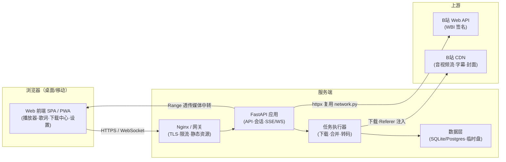

# Bili23 网页端集成技术方案

| 项目 | 说明 |
| --- | --- |
| 文档版本 | v1.0（2026-10-13） |
| 评估对象 | Bili23（windows / linux / android 三端源码仓） |
| 评估主题 | 现有功能能否集成到网页端（浏览器）运行，以及可行时的技术方案 |
| 核心结论 | **"原样移植"不可行；"功能网页化"可行。推荐"Web 前端重写 + Python 后端复用现有业务代码"的 B/S 架构路线** |

---

## 1. 背景与目标

Bili23 是一个 B 站视频/音频下载与播放应用，目前有三端：

- **Windows 桌面版**（主代码库，`windows/`）：PySide6 + PySide6-Fluent-Widgets 实现 GUI，基于 B 站官方 Web API + WBI 签名自研下载引擎（未使用 yt-dlp），ffmpeg 负责音视频合并与转码。
- **Linux 桌面版**（`linux/`）：与 Windows 版近乎同构，替换平台相关实现（ffmpeg、热键、Cookie 路径等）。
- **Android 版**（`android/`）：Kotlin + Jetpack Compose 独立重写，Media3 播放，OkHttp 网络。

本次目标：**评估现有功能在浏览器中运行的可行性，并给出可落地的网页端技术方案**。

---

## 2. 现状盘点

### 2.1 功能清单

| 分类 | 功能点 |
| --- | --- |
| 内容浏览 | 视频搜索、UP 主搜索、UP 主投稿列表、5 种排序、分页、B 站收藏夹浏览 |
| 下载引擎 | DASH 音视频分流下载并合并 MP4、纯音频下载、弹幕 XML、封面；多 P 选集；画质选择（360P~4K/杜比/HDR/60 帧）；分片多线程；断点续传；令牌桶限速；并发数控制；暂停/恢复/取消；磁盘空间校验 |
| 转码与整理 | ffmpeg 转换 MP3/FLAC/WAV/AAC/OPUS 并嵌入封面；按歌手/专辑/分区自动归类；自动抽取音频 |
| 音频播放 | 播放/上下曲、四种播放模式、倍速、音量/静音、迷你播放器；**均衡器 EQ**（10 频段 7 预设）；**恒定音量**；**定时关闭**；**桌面悬浮歌词**（声浪+卡拉 OK 渐变+双语）；**全局快捷键**；歌单导入/导出；同步到 transfer 文件夹；播放列表/音乐收藏夹/按歌手/按专辑四种视图；重扫/清理空文件 |
| 歌词 | LRC 解析、原文/翻译/双语三模式、渐变动画；**在线搜索**（B 站 CC 字幕→网易云兜底）；**联网翻译**（DeepSeek AI→百度→MyMemory）；偏移微调；手动加载；编辑保存；纯音乐标记 |
| 视频播放 | 本地视频播放、全屏独立窗口、倍速、自动连播、上下曲、标签编辑、重命名/删除/打开目录、按 UP 主分组 |
| 账号 | 二维码登录、Cookie 手动登录、Cookie 管理 |
| 其他 | 首页统计、设置页（主题/云母/置顶/下载路径/画质/线程/限速/音频格式/归类/封面/快捷键/AI Key）、SQLite 数据库、系统托盘、单实例 |

### 2.2 技术栈与依赖

| 层 | 技术 | 说明 |
| --- | --- | --- |
| GUI | PySide6 ≥6.6.0、PySide6-Fluent-Widgets ≥1.5.0 | 全部界面 |
| 网络 | httpx ≥0.26.0 | 直连 B 站 API（WBI 签名），未使用 yt-dlp |
| 媒体 | PySide6.QtMultimedia（QMediaPlayer/QVideoWidget） | 音视频播放 |
| 下载/转码 | ffmpeg（PyInstaller 打包内置 bin/ffmpeg.exe）、ffmpeg-python | 合并 DASH 流、转码、嵌封面 |
| 标签 | mutagen ≥1.47.0 | 写本地音频标签 |
| 快捷键 | pynput ≥1.7.6 | 系统级全局键盘钩子 |
| 加密 | cryptography ≥42.0.0 | AES-GCM 解密浏览器 Cookie |
| 其他 | qrcode、pillow、sqlite3 | 二维码、图片、本地数据库 |

### 2.3 代码规模与分层

| 模块 | 行数 | 职责 | 网页端去向 | 复用度 |
| --- | --- | --- | --- | --- |
| `src/bilibili_api.py` | 618 | B 站 API 封装 + WBI 签名 | 后端服务层 | 高（几乎原样） |
| `src/network.py` | 269 | httpx 会话/代理/重试 | 后端服务层 | 高（几乎原样） |
| `src/downloader.py` | 927 | 分片多线程下载/合并/转码/限速/续传 | 后端任务执行器 | 高（逻辑复用，改为队列驱动） |
| `src/database.py` | 804 | 播放历史/收藏/歌单（SQLite） | 后端 DB 层 | 中高（多用户加 user_id） |
| `src/models.py` | 143 | 数据模型 | 后端 | 高 |
| `src/config.py` | 270 | 配置管理 | 后端配置 + 前端偏好拆分 | 中 |
| `src/cookie_manager.py` | 665 | 本机浏览器 Cookie 提取（DPAPI+AES-GCM） | 浏览器中不可用，替换方案见 §7.4 | 低（替换） |
| `src/translate_worker.py` | 192 | AI/百度/MyMemory 翻译 | 后端 API 化 | 高 |
| `src/dependency_checker.py` | 161 | ffmpeg 检查/安装 | 后端复用（容器内预装） | 高 |
| `src/utils.py`、`src/tray.py` | 354 | 文件工具/托盘/单实例 | 部分复用 | 中 |
| GUI 层（`src/gui/*`，含 audio_player_page 3656 行、main_window 2159 行等） | ≈9000 | 全部界面 | **须整体重写为 Web 前端** | 不适用 |

> 结论性观察：业务逻辑层（API/下载/歌词/翻译/数据库，约 3000 行）质量集中、与界面解耦程度尚可，是网页化改造中**最值得复用的资产**；GUI 层是最大工作量。

---

## 3. 核心结论（先给答案）

1. **"把桌面程序直接搬到浏览器跑"不可行**：
   - PySide6 属于桌面 GUI 运行时。虽然 Qt for Python 6.10 起官方文档已把 WebAssembly（wasm32 + Emscripten）列为受支持平台（Chrome/Edge/Firefox/Safari），但浏览器沙箱**没有子进程、没有本地文件系统、没有系统钩子、网络受 CORS 限制**——本项目赖以生存的 ffmpeg 合并、本地媒体库扫描、浏览器 Cookie 解密、全局快捷键、托盘等能力在 WASM 中全部失效；且 QtMultimedia 在 WASM 上仅有 WebAudio/WebVideo 受限后端，加载体积巨大。即使能跑，也只是一个无法完成核心任务的"空壳"。
   - Pyodide（浏览器里跑 CPython）同样不行：Qt/PySide6 不在其支持范围，且网络请求受 CORS 制约。
2. **"功能网页化"可行**：以 Web 前端重写 UI，后端复用现有 Python 业务代码，约 **80%+ 功能**可达到或接近桌面体验；少数桌面专属能力（浏览器 Cookie 自动导入、全局热键、本地目录扫描/写盘）有明确的替代或降级方案（见 §4）。
3. **推荐路线**：前后端分离（方案 B），以"后端复用现有代码 + 前端原生 Web 能力"为纲；如需保留"下载到本机任意目录、自动读取本机浏览器 Cookie"等桌面级体验，可后置叠加"本地伴生程序"（方案 C）。

---

## 4. 网页端可行性逐项分析

| 功能 | 网页端可行性 | 网页端实现方案 |
| --- | --- | --- |
| 搜索 / UP主 / 收藏夹浏览 | ✅ 可行 | 后端复用 `bilibili_api.py`；前端展示 |
| 视频详情 / 多P选集 / 画质选择 | ✅ 可行 | 后端返回播放信息（WBI 签名逻辑原样复用） |
| 视频/音频下载 + DASH 合并 | ✅ 可行（需后端） | 服务端下载 + ffmpeg 合并，浏览器另存；纯前端路线受限（见 §5） |
| 分片多线程 / 断点续传 / 限速 | ✅ 可行 | 服务端任务执行器复用现有逻辑 |
| 转码 MP3/FLAC/WAV/AAC/OPUS + 嵌封面 | ✅ 可行 | 服务端 ffmpeg + mutagen 复用 |
| 弹幕 XML / 封面下载 | ✅ 可行 | 服务端复用 |
| 二维码登录 | ✅ 可行 | 后端代理 B 站二维码流程，前端扫码 |
| Cookie 手动登录 | ✅ 可行 | 用户粘贴 Cookie 字符串，后端加密保存 |
| 本机浏览器 Cookie 自动导入 | ❌ 不可行（沙箱） | 替代：二维码登录 / 手动粘贴 /（可选）浏览器扩展或本地伴生程序 |
| 在线播放（视频/音频） | ✅ 可行 | 服务端媒体中转（Range 透传）→ `<video>/<audio>`；规避 CORS/防盗链 |
| 均衡器 EQ（10 频段 7 预设） | ✅ 可行 | Web Audio：10 × BiquadFilterNode(peaking) 串联 |
| 恒定音量 | ✅ 可行（近似） | Web Audio：DynamicsCompressorNode + GainNode + 限幅级联，参数映射见 §7.3 |
| 定时关闭 | ✅ 可行 | 前端计时器 + 服务端校时 |
| 桌面悬浮歌词 | ⚠️ 部分可行 | Document Picture-in-Picture（Chrome/Edge 116+、Firefox 151+，Safari 不支持）或独立小窗/PWA 窗口降级 |
| 歌词显示（LRC/双语/动画） | ✅ 可行 | 前端重写，纯展示逻辑迁移 |
| 在线歌词搜索（CC字幕→网易云） | ✅ 可行 | 后端代理（上游接口无跨域许可） |
| 联网翻译（DeepSeek/百度/MyMemory） | ✅ 可行 | 后端转发，保护 API Key |
| 全局快捷键 | ❌ 不可行（沙箱） | 替代：navigator.mediaSession 系统媒体键（播放/暂停/上下一曲）+ 页面内快捷键 |
| 音乐库（按歌手/专辑/播放列表视图） | ✅ 可行 | 数据层 IndexedDB / 服务端 DB |
| 歌单导入/导出 | ✅ 可行 | File API / 上传下载 |
| 本地媒体库扫描（文件夹） | ⚠️ 受限 | File System Access API 仅 Chromium 桌面支持；Safari/Firefox 无目录选择器。建议改为"在线播放 + 下载归档"模式 |
| 播放历史 / 收藏 / 歌单持久化 | ✅ 可行 | IndexedDB（单机）或服务端 DB（跨设备） |
| 纯音乐标记 / 标签编辑 | ⚠️ 部分可行 | 在线库元数据可编辑；本地文件标签需先导入（Chromium 可写回） |
| 系统托盘 / 单实例 / 云母特效 | ➖ 不适用 | Web 无对应概念，用主题切换替代 |
| transfer 同步 / 清理空文件 | ➖ 不适用 | 取决于本地文件方案，PWA 场景下取消 |
| 多端适配（手机浏览器） | ✅ 可行（加分项） | 响应式 + PWA，可覆盖部分移动端场景，与现有 Android 端互补 |

图例：✅ 可行 / ⚠️ 部分可行或有条件 / ❌ 不可行 / ➖ 不适用。

---

## 5. 关键技术约束与依据

### 5.1 网络层：CORS、第三方 Cookie、防盗链、风控（最关键约束）

- **CORS**：B 站 `api.bilibili.com` 未向任意第三方域名开放跨域许可。本方案写作时实测：不带完整会话上下文（浏览器 UA、Cookie 等）的直连请求会被边缘 WAF 直接返回 `403`（openresty，HTML 体），跨源 `fetch` 无法依赖。→ **第三方网页直接调用 B 站 API 不可靠，必须经自有后端代理**。
- **第三方 Cookie 策略**：现代浏览器（Chrome 第三方 Cookie 淘汰、Safari ITP、Firefox TCP）会阻止/分区跨站 Cookie。即使 API 允许跨域，"把用户 SESSDATA 塞进第三方页面直连"的模式也不成立。→ 用户登录态应由**后端会话持有**（用户凭据加密存储在服务端），天然规避该问题。
- **媒体防盗链**：B 站 CDN（bilivideo 等）按 Referer 白名单校验，第三方站点直连播放/下载易 403。→ 播放与下载均走**服务端中转**（注入合法 Referer/UA 后 Range 透传）。
- **风控**：WBI 签名、频率限制、验证码。→ 复用现有签名模块；服务端集中请求需限速、退避、复用用户会话，避免触发风控。

### 5.2 运行环境：PySide6 WASM 与 Pyodide

| 方案 | 官方支持 | 结论 |
| --- | --- | --- |
| PySide6 + Qt for WebAssembly | Qt for Python 6.10 官方列出 WebAssembly（wasm32/Emscripten 4.0.7，四大桌面浏览器） | 理论可编译运行 UI，但无子进程/本地文件/系统钩子，QtMultimedia 仅 WebAudio/WebVideo 受限后端，体积大。**不可用于交付完整功能** |
| Pyodide（浏览器跑 CPython） | 支持纯 Python 包（pip/micropip） | PySide6/Qt 不在支持范围；httpx 网络受 CORS 限制。**仅可作为个别算法复用备选，不推荐作为主路线** |

### 5.3 媒体处理：ffmpeg.wasm 与替代

| 方案 | 说明 | 适用性 |
| --- | --- | --- |
| ffmpeg.wasm | 浏览器内运行 ffmpeg；**多线程版依赖 SharedArrayBuffer，页面需配置 COOP/COEP 响应头**；单线程版无需但性能低；core 体积约 25MB+ | 仅方案 A（纯前端）需要；转码场景性能存疑 |
| mp4box.js / mp4-muxer | 浏览器原生 JS 做 fMP4 **转封装**（不重编码） | 若只需输出 MP4 合并，可免 ffmpeg；MP3/FLAC 等转码仍须 ffmpeg |
| 服务端 ffmpeg | 现有 `downloader.py` 逻辑直接复用 | **推荐**（方案 B/C） |

### 5.4 浏览器原生能力支持度（用于前端选型）

| API | 用途 | 支持度 |
| --- | --- | --- |
| Web Audio API（BiquadFilter / DynamicsCompressor） | EQ、恒定音量 | 全平台支持 |
| Media Session API | 系统媒体键、媒体通知 | Chromium/Safari/Firefox 支持 |
| Document Picture-in-Picture | 桌面悬浮歌词替代 | Chrome/Edge 116+、Firefox 151+；**Safari 不支持** |
| File System Access（showDirectoryPicker/showSaveFilePicker） | 本地媒体库、直接写盘保存下载 | 仅 Chromium 系桌面；Firefox/Safari 不支持 |
| SharedArrayBuffer（COOP/COEP） | ffmpeg.wasm 多线程 | 需服务端配置响应头 |

---

## 6. 架构方案对比与选型

### 方案 A：纯前端（静态托管 + WASM）

`静态站点（SPA）` + `Pyodide/TS 复刻业务逻辑` + `ffmpeg.wasm` + 一个**CORS 中转**（Serverless 函数）。

- 优点：无重后端、部署轻、隐私好（文件不经过服务器）。
- 缺点：API 与媒体仍需中转层（否则 CORS/防盗链无解）；ffmpeg.wasm 体积与性能差；Cookie/登录链路脆弱；转码能力受限。
- 适用：仅做"在线浏览 + 轻量播放"的轻工具。

### 方案 B：前后端分离（推荐）

`Web 前端（SPA/PWA）` ⇄ `Python 后端（FastAPI）` ⇄ `B 站 API / ffmpeg / 数据库`。

- 优点：**后端可大量复用现有 Python 代码**（见 §2.3 复用度列）；彻底规避 CORS/防盗链/第三方 Cookie；下载、转码、歌词代理能力完整；天然支持多设备（含手机浏览器）；后续可平滑演进（PWA、开放 API）。
- 缺点：需要服务器与带宽；下载文件需回传或在服务器暂存（见 §7.2 优化）；用户凭据存服务端需加密与合规设计。
- 结论：**作为主路线**。

### 方案 C：混合（Web UI + 本地伴生程序，可选增强）

在方案 B 基础上，用户可选安装一个轻量本地程序（可复用现有 Python 代码打包），通过 `127.0.0.1` 提供：下载直写本机目录、浏览器 Cookie 自动导入、本地媒体库扫描、系统级热键。

- 优点：桌面级体验 100% 保留；可做成"网页版 + 桌面增强插件"形态。
- 缺点：安装步骤回来了，纯 Web 用户不用。
- 定位：**后置里程碑（M4）**，服务于"重度用户/桌面用户"，与方案 B 不冲突。

> 选型建议：**以方案 B 为主体交付网页版；方案 C 作为可选的桌面增强通道后置实现**；方案 A 仅在"极简在线播放器"子场景中局部参考。

---

## 7. 推荐方案（B）详细设计

### 7.1 总体架构

### 7.2 后端设计（复用优先）

**模块复用映射**

| 现有代码 | 后端改造 |
| --- | --- |
| `bilibili_api.py`、`network.py` | 直接作为服务层，包装为 REST 接口（搜索/详情/播放地址/二维码登录/收藏夹） |
| `downloader.py` | 抽为任务执行器：接受队列任务（新增/暂停/恢复/取消），保留分片并发、令牌桶限速、断点续传；进度经 WebSocket/SSE 推送 |
| `database.py`、`models.py` | 增加 `user_id` 维度实现多用户隔离；或单用户模式延用 SQLite |
| `translate_worker.py` | 包装为 `/api/translate`，Key 存服务端 |
| 歌词搜索逻辑 | 包装为 `/api/lyrics/search`（CC 字幕→网易云兜底链路不变） |
| `dependency_checker.py` | 容器构建期预装 ffmpeg，运行时检活 |
| `cookie_manager.py` | 替换为：手动 Cookie 导入接口 + 二维码登录会话 + （可选）扩展/伴生导入 |

**关键设计点**

- **媒体中转**：`GET /api/media/proxy?url=...`，服务端注入 Referer/UA、支持 HTTP Range 透传、流式转发不落盘；配合短期签名防止被滥用为开放代理。
- **下载交付**：两种模式——
  1. *流式回传*：合并完成后 `Content-Disposition` 流式下载到浏览器（服务器仅临时占用磁盘）；
  2. *服务器归档*：存入对象存储/磁盘，浏览器按需下载（适合大文件/离线保存）。
  优化：合并输出直接边写边传可减少双倍带宽等待；任务临时文件设置 TTL 清理。
- **认证与会话**：Web 应用自有账号（可选）或匿名会话；B 站 SESSDATA 使用 `cryptography`（复用现有依赖）加密落库；登录态过期检测与引导重登。
- **实时通道**：WebSocket 推送下载进度/合并状态/任务完成；断线重连后按任务快照恢复 UI。
- **限流与风控**：全局请求节流 + 单用户配额；对 B 站请求复用现有请求头策略并加入随机退避；触发验证码时向用户透出处理引导。

### 7.3 前端设计

**技术选型**

- 框架：Vue 3 + TypeScript + Vite；状态 Pinia；路由 Vue Router；组件库 Naive UI 或 Element Plus（可按 Fluent 设计语言自定义主题，延续现有观感）。
- 播放器：原生 `<video>/<audio>` + 自研控制层（对接媒体中转接口）；如需 DASH 可结合 MSE + mp4box.js 做转封装播放。
- 样式：响应式布局（桌面三栏 / 移动单栏），支持深色模式与主题色，对齐现有 Fluent 风格。

**页面映射**

| 桌面页面 | Web 页面 |
| --- | --- |
| 首页统计 | 仪表盘（下载/播放/收藏统计卡片） |
| 搜索 / 视频详情 / 收藏夹 | 搜索页、详情页（含多P选集、画质选择、下载入口） |
| 下载管理 | 下载中心（队列/进度/速度/暂停恢复、SSE 实时刷新） |
| 音频播放器 | 音乐库 + 播放器页（列表四种视图：播放列表/收藏/歌手/专辑） |
| 视频播放器 | 视频库 + 播放页（连播、倍速、上下曲） |
| 歌词（含桌面歌词、编辑器） | 歌词面板 + PiP 悬浮歌词 + 歌词编辑弹窗 |
| 设置 | 设置页（偏好存 IndexedDB；账号/凭据在后端） |
| 登录 | 二维码扫码 / Cookie 粘贴 |

**音效实现（Web Audio 映射）**

| 桌面能力 | Web 实现 | 参数 |
| --- | --- | --- |
| 10 频段 EQ（7 预设） | 10 × `BiquadFilterNode`（type=peaking）串联 | 复用现有频点与增益表 |
| 恒定音量 | `DynamicsCompressorNode`（压缩级）→ `GainNode`（补偿）→ `DynamicsCompressorNode`（限幅级） | 阈值 -26dB、比率 6:1、增益 +9dB、限幅 -1.5dB/12:1、attack 8ms、release 220ms（与桌面参数一一对应；为近似实现，效果弱于 Android 系统级 DynamicsProcessing） |
| 音量/静音/倍速 | `GainNode` / `playbackRate` | — |

**其他前端能力**

- 定时关闭：`setTimeout` + 播放器钩子，支持"播完当前曲目"选项。
- 悬浮歌词：`documentPictureInPicture.requestWindow()` 渲染歌词组件（特性检测，降级为独立窗口/PWA 小窗或页内全屏歌词模式）；动画（渐变、声浪）用 CSS/Canvas 复刻。
- 系统媒体键：`navigator.mediaSession` 注册 play/pause/previoustrack/nexttrack，元数据（封面/标题/歌手）同步。
- 数据存储：偏好与小型数据 localStorage/IndexedDB；歌单/历史/收藏可选服务端同步（跨设备）。
- PWA：可安装、离线壳缓存、移动端友好（对 Android 端的补充而非替代）。

### 7.4 音源方案（音乐播放的来源）

桌面版"音乐库"的音源 = 本地下载文件夹（扫描本地文件）；浏览器没有本地目录权限，因此 Web 版把音源抽象为三类，由 API 层统一归一为 `MediaSource`（{播放地址, 请求头, 时长, 元数据}），播放器与音乐库对来源无感：

| 音源 | 来源 | 适用场景 | 优点 | 代价 / 限制 |
| --- | --- | --- | --- | --- |
| ① 在线流（默认） | 后端调 playurl 取 B 站音频流，经媒体中转 Range 透传 | 即点即听，曲库 = 整个 B 站 | 零存储、零导入、秒播 | 依赖网络与服务器带宽；离线不可用；直链有有效期 |
| ② 服务器归档 | 下载任务完成后在服务器留档（磁盘/对象存储），音乐库 = 服务端文件 | 自部署用户、跨设备同步、离线缓听 | 多端一致、可离线 | 服务器磁盘与流量成本；内容存服务端 |
| ③ 本地文件 | File System Access API 授权本地文件夹（Chromium 桌面）；Firefox/Safari 降级"选择文件"；或经本地伴生程序（方案 C）映射 localhost | 桌面用户直接听已下载的音乐（可复用桌面版下载目录） | 零服务器成本、隐私最佳、可写回标签 | 目录扫描仅 Chromium 系；需用户授权 |

实现要点：

- **格式兼容**：B 站音频流为 DASH fMP4（.m4s），必要时由服务端 ffmpeg `-c copy` 秒级转封装为 .m4a（不重编码），保证 `<audio>` 兼容并支持 Range 拖动。
- **直链时效**：playurl 直链带 deadline（小时级），播放失败时自动向后端重取；预取下一曲时同步预取新地址。
- **音质与登录**：高码率/Hi-Res 依赖登录态（SESSDATA），沿用 §7.2 服务端会话方案。
- **默认策略**：① 为默认；设置中开启"下载时在服务器保留副本"即获得 ②；授权本地目录即获得 ③。三者可同时出现在音乐库中，以来源徽标区分。

### 7.5 关键流程

**二维码登录**

1. 前端请求 `/api/login/qrcode` → 后端调用 B 站申请二维码（复用现有登录逻辑）；
2. 返回二维码图片/链接 → 前端展示；前端轮询 `/api/login/qrcode/poll`；
3. 后端轮询 B 站直至成功，加密保存 SESSDATA 等凭据；返回登录态与用户信息。

**下载流程**

1. 前端在详情页提交下载任务（画质/编码/音质/输出格式）→ `POST /api/tasks`；
2. 后端任务执行器分片下载（复用 `downloader.py`）→ ffmpeg 合并/转码 → 写封面标签；
3. 进度经 WebSocket 实时推送（速度/分片/剩余）；
4. 完成后按模式交付：浏览器流式下载保存，或归档到服务器供下载页取回。

**播放流程**

1. 前端请求 `/api/play/url?bvid=..` → 后端返回经校验的可播信息（可含签名后的中转地址）；
2. `<video>/<audio>` 请求中转地址 → 服务端注入 Referer/UA、Range 透传；
3. 前端挂载 Web Audio 图（EQ/恒定音量）与歌词组件。

### 7.6 部署与运维

- **容器化**：Docker Compose 起步：`nginx`（TLS/静态/反代）+ `api`（FastAPI + 内置任务执行器 + ffmpeg）。规模上来后再拆独立 worker + 队列（Redis/RQ 或 arq）。
- **HTTPS**：全站 TLS；如走方案 A 的 ffmpeg.wasm 路线需额外配置 `Cross-Origin-Opener-Policy: same-origin` 与 `Cross-Origin-Embedder-Policy: require-corp`。
- **带宽与存储**：媒体中转为纯流量型开销，需评估服务器带宽；建议：Range 透传（边看边传）、临时文件 TTL、开启 gzip/br（文本类）与 CDN 前置（静态资源）。
- **配置**：AI Key、并发上限、限速默认值等服务端配置化；用户偏好前端本地化。

### 7.7 安全与合规

- **凭据安全**：SESSDATA 属高敏感凭据，落库 AES-GCM/Fernet 加密（复用 `cryptography`），接口按会话鉴权，日志脱敏。
- **代理防滥用**：媒体中转地址加短期签名 + 域名白名单（仅 B 站相关域），避免成为开放代理。
- **平台合规**：遵守 B 站用户协议与相关法律法规；建议定位为**个人自用/个人自部署**形态，控制请求频率与并发，不提供面向公众的公开下载服务；对版权内容仅限用户自身授权范围内使用。

---

## 8. 主要风险与对策

| 风险 | 影响 | 对策 |
| --- | --- | --- |
| B 站接口/风控策略变更（WBI、验证码） | 核心链路失效 | 接口层已模块化（`bilibili_api.py`），升级点集中；关注社区动态快速跟进 |
| 服务端 IP 被限流/封禁 | 请求失败 | 请求节流+退避+复用用户会话；必要时支持自定义出口代理（现有 `network.py` 已支持代理配置） |
| 带宽成本超预期 | 运营成本 | Range 透传不落盘；限制单用户并发；引导"仅转存服务器"或"下载归档"模式 |
| 浏览器兼容差异（PiP/FSA 不可用） | 个别功能降级 | 特性检测 + 渐进增强：自动降级为页内歌词/普通下载 |
| 用户凭据集中存储 | 安全事故面 | 加密存储、最小权限、定期失效提醒；提供"不保存凭据"的临时会话模式 |
| 版权与平台条款 | 合规风险 | 自用定位、频率限制、不公开分发下载能力；提供风险提示文案 |

---

## 9. 实施路线（里程碑）

| 阶段 | 内容 | 交付物与验收点 |
| --- | --- | --- |
| **M0 技术预研** | FastAPI 骨架 + 媒体中转 PoC + 长音频流播放 | 能通过后端中转播放任意 B 站视频/音频；验证 CORS/防盗链绕过方案 |
| **M1 在线 MVP** | 搜索/UP主/收藏夹浏览、详情页、在线播放、二维码登录、Cookie 粘贴登录 | 不登录可浏览播放；登录后可见高画质；移动端浏览器可用 |
| **M2 下载中心** | 任务队列、分片多线程、合并/转码、封面标签、进度推送、浏览器保存 | 下载产物与桌面端一致（可正常播放的 MP4/MP3/FLAC…）；断点续传可用 |
| **M3 播放增强与音乐库** | 音乐库/歌手/专辑视图、歌单导入导出、歌词（显示/搜索/翻译/编辑）、EQ、恒定音量、定时关闭、PiP 歌词、媒体键 | 音质音效体验对齐桌面端主要能力；歌单互通 |
| **M4 跨设备与增强通道** | 服务端数据同步、PWA、移动端适配完善；可选：本地伴生程序（Cookie 导入/直写本机/全局热键） | 手机浏览器完整可用；伴生程序试点桌面纯离线场景 |

---

## 10. 结论与建议

1. **Bili23 无法"原样"集成到网页端运行**：桌面 GUI 与系统级能力在浏览器沙箱中不可用；WASM（PySide6 WebAssembly / Pyodide）路线无法承载本项目核心功能，不建议投入。
2. **功能网页化完全可行**，且复用度可观：约 3000 行 Python 业务逻辑可服务端原样/轻改造复用；主要工作量在约 9000 行 GUI 的 Web 重写。
3. **首选架构为"前后端分离"（方案 B）**：后端 FastAPI 复用现有下载器与 API 模块；前端 Vue 3 重写界面并用 Web 原生能力（Web Audio、Media Session、Document PiP、PWA）复刻播放体验。桌面专属能力以"替代方案"消解（浏览器 Cookie 导入→二维码登录/扩展/伴生程序；全局热键→媒体键+页内快捷键；本地目录→File System Access / 下载归档）。
4. **建议推进顺序**：先做 M0 的媒体中转 PoC（它验证了整条可行性链路中风险最高的一环），通过后按 M1→M4 逐期交付。

---

## 附录：参考资料

- [Qt for Python 支持平台（含 WebAssembly）](https://doc.qt.io/qtforpython-6.10/overviews/qtdoc-supported-platforms.html)
- [Qt for WebAssembly 文档](https://doc.qt.io/qt-6/wasm.html)、[Qt Wiki: Qt for WebAssembly（qtmultimedia 限制）](https://wiki.qt.io/Qt_for_WebAssembly)
- [Qt Multimedia 目标平台与后端（WASM 的 WebAudio/WebVideo）](https://doc.qt.io/QT-6/qtmultimedia-index.html)
- [Pyodide 官方文档](https://pyodide.org/en/latest/)
- [MDN：跨源资源共享（CORS）](https://developer.mozilla.org/zh-CN/docs/Web/HTTP/Guides/CORS)
- [MDN：Document Picture-in-Picture API 兼容性](https://developer.mozilla.org/en-US/docs/Web/API/Document_Picture-in-Picture_API)
- [MDN：File System API 兼容性](https://developer.mozilla.org/zh-CN/docs/Web/API/File_System_API)、[showDirectoryPicker() 兼容性](https://developer.mozilla.org/ko/docs/Web/API/Window/showDirectoryPicker)
- [ffmpeg.wasm 使用文档（SharedArrayBuffer / COOP-COEP 要求）](https://ffmpegwasm.netlify.app/docs/getting-started/usage/)
- [MP4Box.js（浏览器端 MP4 解析/封装）](https://www.npmjs.com/package/mp4box)