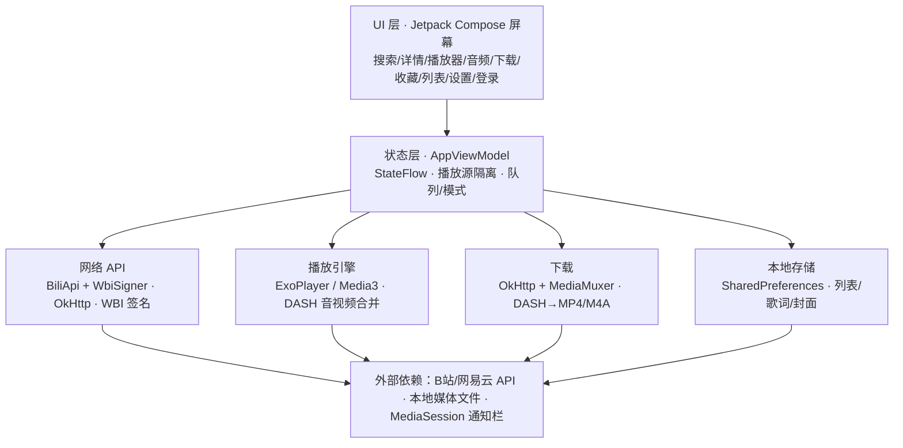

# Bili23-Android 技术路线

> B 站视频/音频下载与播放的 Android 客户端，单 Activity + Jetpack Compose 架构。

## 整体框架

- 语言 / UI：纯 Kotlin，Jetpack Compose 声明式 UI，Material3
- 路由：Navigation Compose（底部导航 6 页 + 抽屉菜单）
- 状态：全局 `AppViewModel`（`AndroidViewModel` + `StateFlow`）
- 网络：OkHttp
- 播放：Media3 / ExoPlayer
- 图片：Coil（注入 B 站 UA/Referer）
- 构建：minSdk 26 / targetSdk 36，Kotlin + compose 插件
- 关键依赖：`navigation-compose`、`coil-compose`、`okhttp`、`media3-exoplayer`、`media3-ui`、`zxing`（见 `app/build.gradle.kts`）

## 1. 网络层

文件：`app/src/main/java/com/bili23/android/data/BiliApi.kt`、`WbiSigner.kt`

- OkHttp 客户端：connect/read/write 15s/30s/30s 超时，跟随重定向；所有请求带 B 站 UA / Referer / Origin，登录后自动附带 Cookie。
- **WBI 签名**：从 `/nav` 拉取并缓存 `img_key` / `sub_key`（10 分钟 TTL）→ 混淆取 mixin key → 参数按 key ASCII 排序拼接 → MD5 生成 `w_rid`；`quote` 采用 Python `safe='~'` 语义，中文按 UTF-8 百分号编码。
- 接口清单：
  - `nav`：登录态 / 用户信息 / WBI key
  - `wbi/search/type`：搜索视频（分页）
  - `view`：视频详情（含分P）
  - `player/wbi/playurl`：DASH 播放地址（`fnval=16`，自动挑最高质量视频/音频流）
  - `passport`：二维码登录 generate / poll
  - 网易云：`music.163.com` 搜索 + 歌词（原词 / 翻译）
  - `fav` 系列：收藏夹列表与内容
- 全部切换 `Dispatchers.IO`，异常统一降级为空数据。

## 2. 数据模型与本地存储

文件：`data/Models.kt`、`data/Settings.kt`

- 数据类：`VideoInfo / EpisodeInfo / PlayUrl / DownloadTask / AudioItem / UserInfo / QrLogin / FavoriteFolder` 等。
- **SharedPreferences** 持久化：
  - 主题、默认画质、Cookie、下载目录名
  - 播放列表（JSON，按 视频/音频 双命名空间，含默认收藏列表）
  - 自定义排序（多选拖拽调整位置）
  - 音频标签、歌词偏移；旧版收藏/列表自动迁移
- **文件落盘**：歌词 `.lrc`、翻译 `.lrc.tl`、封面 `.jpg` 与媒体文件同目录；下载目录为应用私有外部目录（默认 `Download/`，下含 `videos/`、`audios/`）。

## 3. 下载模块

文件：`data/DownloadManager.kt`

- 视频：并行流式下载 DASH 视频流（`.m4v`）+ 音频流（`.m4a`），用 **MediaMuxer** 合并封装为 MP4，存 `videos/`。
- 音频：仅下载 DASH 音频流，保存为 M4A，存 `audios/`。
- 进度状态机：下载中 → 合并中 → 完成 / 失败；`StateFlow<List<DownloadTask>>` 驱动 UI；支持取消。
- 细节：
  - `activeTempFiles` 追踪临时文件，避免被磁盘扫描误当成品
  - 封面旁路下载 `.jpg`（失败不阻塞主流程）
  - 文件名按 UTF-8 字节数截断（防 ENOENT），非法字符替换
  - 磁盘扫描恢复记录（清空下载历史后文件仍显示）

## 4. 视频播放

文件：`ui/screens/VideoDetailScreen.kt`、`ui/screens/VideoPlayerScreen.kt`

- 详情页：选集（分P）/ 画质选择 → 拉取 DASH 地址 → `setCurrentPlay` 在线播放；在线播放时**清空本地播放路径**，避免误跳本地。
- 播放器：ExoPlayer + `MergingMediaSource` 合并视频+音频流播放（带 Referer）；本地播放用 `Uri.fromFile`。
- 播放队列：
  - 本地：顺序 / 列表循环 / 单曲循环 / 随机，下方显示已下载视频列表
  - 在线：多P 选集队列 + 自动连播 + 下方选集列表
- 自绘控制条：`SlimProgressBar` 细条进度 + 拖动；双击画面播放/暂停；全屏强制横屏；通知栏控制（`VideoMediaNotification`）。

## 5. 音频播放

文件：`service/MusicPlaybackService.kt`、`ui/screens/AudioPlayerScreen.kt`

- **前台 Service** 持有 ExoPlayer，息屏 / 切后台续播。
- `MediaSessionCompat` + 通知栏：播放/暂停/上一首/下一首/定时关闭（15/30/60 分钟循环）。
- 关键点：ExoPlayer 只允许主线程访问 → 用主线程 `Handler` 轮询同步进度（避免 `IllegalStateException: Player is accessed on the wrong thread`）。
- 歌词：网易云搜索 + LRC 解析（原词 / 翻译双段）+ 滚动高亮 + 300ms 缩放/透明度动画 + 偏移微调 + 本地编辑；支持标签编辑与按标签重命名文件。

## 6. 登录

文件：`ui/screens/LoginScreen.kt`、`ui/QrCodeHelper.kt`

- 二维码登录：`generate` 生成二维码 → 轮询 `poll` → 从回调 URL 解析 + 合并 `Set-Cookie` 响应头提取 Cookie。
- 支持手动输入 Cookie。
- 登录态存 SharedPreferences；登录后解锁「我的收藏」与更高画质。

## 7. 本地媒体管理

文件：`ui/screens/LocalVideoScreen.kt`、`DownloadsScreen.kt`、`PlaylistsScreen.kt`、`FavoritesScreen.kt`

- 磁盘扫描本地视频 / 音频（独立于下载记录，以磁盘文件为权威）。
- 收藏、命名播放列表、编辑标签、多选批量删除 / 加入列表。
- **拖拽重排**：`ui/components/DragDropList.kt`（长按行右侧手柄拖动）+ `animateItem` 滑动动画，顺序持久化到自定义排序。

## 8. UI 基础设施

文件：`MainActivity.kt`、`Bili23App.kt`、`ui/Theme.kt`

- 底部导航 6 页（首页/搜索/视频/下载/音频/设置）+ 抽屉菜单（含播放列表、收藏）。
- 全屏控制器：视频全屏时禁用抽屉手势。
- Material3 主题（跟随系统 / 浅色 / 深色，默认跟随系统）。
- 自定义组件：`SlimProgressBar`、`CompactIconButton`、`DragDropList`。
- Coil 统一加载封面（应用级 ImageLoader 注入 UA / Referer / 淡入动画）。
